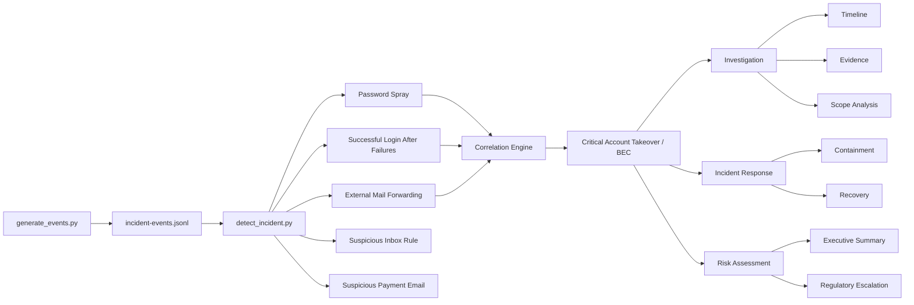
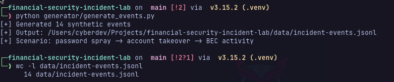
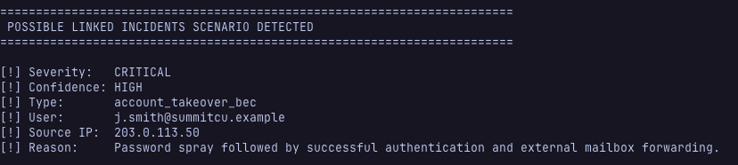

# Financial Security Incident Lab

A synthetic financial-sector security lab demonstrating detection engineering, incident correlation, investigation, response, and cybersecurity risk communication through a simulated account takeover and Business Email Compromise (BEC) scenario.

> **Safety:** All identities, domains, IP addresses, events, and organizations used in this project are fictional. No production systems, credentials, customer information, or real financial institution data are used.

---

## Project Overview

This project follows a simulated security incident from initial authentication abuse through detection, investigation, containment, and business-risk assessment.

The scenario begins with password spraying against multiple fictional employee accounts. One targeted identity is successfully compromised and subsequently used to create external mailbox forwarding, conceal payment-related messages, and send updated payment instructions to internal financial personnel.

Rather than treating each event as an isolated alert, the project correlates related activity to determine when multiple suspicious behaviors collectively support a high-confidence incident.

### Scenario

```text
Password Spray
      |
      v
Successful Authentication
      |
      v
Account Takeover
      |
      +--> External Mail Forwarding
      |
      +--> Suspicious Inbox Rule
      |
      +--> Payment-Related Email
      |
      v
Detection Correlation
      |
      v
Critical BEC Incident
      |
      +--> Investigation
      +--> Containment
      +--> Risk Assessment
      +--> Regulatory Escalation Review
```

---

## Objectives

The project demonstrates the ability to:

- Generate deterministic synthetic security telemetry.
- Normalize events using ECS-style field structures.
- Detect password-spray behavior across multiple identities.
- Identify successful authentication following failed attempts.
- Detect external mailbox forwarding.
- Identify suspicious inbox-rule behavior.
- Detect payment-related activity from a compromised account.
- Correlate multiple independent findings into a higher-confidence incident.
- Reconstruct an incident timeline.
- Separate confirmed evidence from unverified impact.
- Scope a security investigation.
- Document containment and recovery actions.
- Translate technical findings into business risk.
- Identify potential regulatory considerations without making unsupported legal conclusions.

---

## Architecture



---

## Repository Structure

```text
financial-security-incident-lab/
|
├── data/
│   └── incident-events.jsonl
|
├── generator/
│   └── generate_events.py
|
├── detections/
│   ├── detect_incident.py
│   ├── password-spray.yml
│   └── mailbox-forwarding-rule.yml
|
├── investigation/
│   ├── timeline.md
│   ├── evidence.md
│   └── scope-analysis.md
|
├── response/
│   ├── containment-checklist.md
│   └── incident-response-report.md
|
├── risk/
│   ├── executive-summary.md
│   └── regulatory-escalation.md
|
├── docs/
│   └── detection-output.txt
|
├── screenshots/
│   ├── generate_events.png
│   ├── detect_incident.png
│   └── correlated_incident.png
|
├── requirements.txt
├── .gitignore
└── README.md
```

---

## Synthetic Dataset

The event generator creates a deterministic 14-event incident timeline.

The dataset uses:

- `.example` domains reserved for documentation.
- RFC 5737 documentation-only IP address ranges.
- Fictional users and organizational identifiers.
- ECS-style nested fields such as:
  - `event.action`
  - `event.outcome`
  - `event.dataset`
  - `user.email`
  - `source.ip`

The dataset is stored as JSON Lines:

```text
data/incident-events.jsonl
```

<sub>Each line represents one independent security event.</sub>

---

## Attack Timeline

| Time UTC | Activity | Assessment |
|---|---|---|
| 15:00 | Normal authentication | Baseline user activity |
| 15:14 | Password spray begins | Multiple identities targeted from one source |
| 15:18 | `j.smith` targeted | Future compromised identity enters attack sequence |
| 15:20 | Repeated failure against `j.smith` | Continued targeting |
| 15:21 | Successful authentication | Potential valid-account compromise |
| 15:27 | External forwarding created | BEC collection/persistence behavior |
| 15:31 | Inbox concealment rule created | Payment-related messages hidden |
| 15:42 | Updated payment instructions sent | Potential fraud activity |
| 15:47 | Correlation alert generated | Combined behavior escalated |
| 15:57 | Sessions revoked | Containment begins |
| 15:58 | Account disabled | Immediate unauthorized access stopped |

> See [`investigation/timeline.md`](investigation/timeline.md) for the complete investigation timeline.

---

## Detection Engineering

The Python detection engine produces five independent findings:

1. Password Spray
2. Successful Login After Failures
3. External Mail Forwarding
4. Suspicious Inbox Rule
5. Suspicious Payment Email

> The project intentionally separates individual detections from incident correlation.

<sub>A password spray alone does not prove account compromise. Likewise, a mailbox forwarding rule may have a legitimate explanation.</sub>

Confidence increases substantially when the same source:

1. Generates failed authentication against multiple identities.
2. Successfully authenticates to one of those identities.
3. Creates external mailbox forwarding for the compromised account.

The correlation engine therefore raises:

```text
Type:       account_takeover_bec
Severity:   CRITICAL
Confidence: HIGH
```
---

### Synthetic Dataset

The generator creates a deterministic 14-event incident timeline.



---

### Detection Result

The detection engine identifies five findings and correlates them into a
high-confidence account takeover / BEC incident.



[View full detection output screenshot](screenshots/detect_incident.png)

---

## Sigma Detection Rules

Two Sigma-format detection artifacts are included:

### Password Spray

[`detections/password-spray.yml`](detections/password-spray.yml)

The rule uses a `value_count` correlation to identify one source IP generating failed authentication against four or more distinct user identities within ten minutes.

### Mailbox Forwarding

[`detections/mailbox-forwarding-rule.yml`](detections/mailbox-forwarding-rule.yml)

The rule identifies creation of mailbox forwarding configuration for additional analyst review.

> The local Python detection engine performs additional context-aware analysis, including comparing the user's domain with the forwarding destination.

<sub>> The Sigma rules use custom synthetic log sources and ECS-style fields. Production use would require field mapping appropriate to the target SIEM and telemetry source. Backend support for Sigma correlation features should also be validated before deployment.</sub>

---

## MITRE ATT&CK Mapping

| Scenario Behavior | MITRE ATT&CK | Tactic |
|---|---|---|
| Password spraying against multiple identities | T1110.003 - Password Spraying | Credential Access |
| Successful use of compromised credentials | T1078 - Valid Accounts | Initial Access / Persistence / Privilege Escalation / Defense Evasion |
| External mailbox forwarding | T1114.003 - Email Forwarding Rule | Collection |

<sub>The mapping focuses only on behaviors directly supported by the synthetic evidence rather than forcing every event into an ATT&CK technique.</sub>

---

## Investigation

The investigation stage documents three separate analyst concerns:

### Timeline Reconstruction

> [`investigation/timeline.md`](investigation/timeline.md)

Reconstructs the incident chronologically and distinguishes baseline behavior from attack and response activity.

### Evidence Assessment

[`investigation/evidence.md`](investigation/evidence.md)

Documents the evidence supporting the incident classification and explains how confidence changes when multiple findings are correlated.

### Scope Analysis

> [`investigation/scope-analysis.md`](investigation/scope-analysis.md)

Separates confirmed compromise from unanswered investigative questions.

<sub>The synthetic evidence confirms one compromised identity but does not assume that one confirmed account represents the full scope of the incident.</sub>

---

## Incident Response

> [`response/containment-checklist.md`](response/containment-checklist.md) separates confirmed response actions from additional recommended containment steps.

The synthetic dataset confirms:

- Active sessions were revoked.
- The affected account was disabled.

<sub>Additional investigation and containment would still be required before declaring the incident fully contained.</sub>

> The complete incident report is available at: [`response/incident-response-report.md`](response/incident-response-report.md)

---

## Risk Communication

Detection is only one part of an analyst's responsibility.

The project therefore translates technical evidence into:

- Potential financial risk
- Potential information exposure
- Operational risk
- Reputational risk
- Management decision points
- Residual risk

> The executive-facing assessment is available at: [`risk/executive-summary.md`](risk/executive-summary.md)

The report deliberately distinguishes potential impact from confirmed impact.

For example:

```text
Potential Financial Impact: High
Confirmed Financial Loss:   None identified
```

<sub>This prevents uncertainty from being presented as established fact.</sub>

---

## Regulatory Escalation

The project includes a simulated regulatory-escalation assessment: [`risk/regulatory-escalation.md`](risk/regulatory-escalation.md)

The analyst identifies facts, preserves evidence, documents uncertainty, and escalates potential regulatory implications to appropriate authorized personnel.

<sub>The project does not attempt to make a final legal or regulatory determination.</sub>

---

## Quick Start

### Requirements

- Python 3
- Git
- PyYAML
- pandas

> The project was developed and tested using Python 3.15.

### Clone

```bash
git clone https://github.com/ktalons/financial-security-incident-lab.git
cd financial-security-incident-lab
```

### Create a Virtual Environment

```bash
python3 -m venv .venv
source .venv/bin/activate
```

### Install Dependencies

```bash
pip install -r requirements.txt
```

### Generate the Dataset

```bash
python generator/generate_events.py
```

Expected result:

```text
[+] Generated 14 synthetic events
[+] Scenario: password spray -> account takeover -> BEC activity
```

### Run Detection

```bash
python detections/detect_incident.py
```

<sub>The detector should identify five findings and correlate the authentication and mailbox activity into a critical, high-confidence account takeover/BEC scenario.</sub>

---

## Detection Philosophy

This lab is built around one principle:

**A suspicious event is not automatically an incident.**

- Individual alerts provide evidence.
- Correlation provides context.
- Investigation establishes scope.
- Response reduces risk.
- Documentation communicates what is known, what remains unknown, and what should happen next.

---

## Lessons Learned

### Telemetry quality matters

Detection logic depends on reliable timestamps, consistent field naming, and trustworthy source data.

### Correlation changes confidence

A failed login or forwarding rule can have benign explanations. Their relationship to other events can transform their significance.

### Scope should be evidence-driven

One confirmed compromised identity does not prove that only one identity was compromised.

### Containment is not recovery

Disabling an account stops immediate access but does not establish that all persistence, exposed credentials, malicious sessions, or downstream impact have been addressed.

### Technical findings must translate into risk

A source IP and authentication event matter because of what they may allow an adversary to do to business processes, sensitive information, and financial operations.

### Uncertainty should remain visible

Potential impact should not be represented as confirmed impact without supporting evidence.

---

#### Disclaimer

<sup>This repository is an educational cybersecurity project.</sup>
<sup>All organizations, identities, email addresses, IP addresses, logs, and incident activity are synthetic and intentionally fictional.</sup>
<sup>The project is not affiliated with or representative of any real financial institution.</sup>
