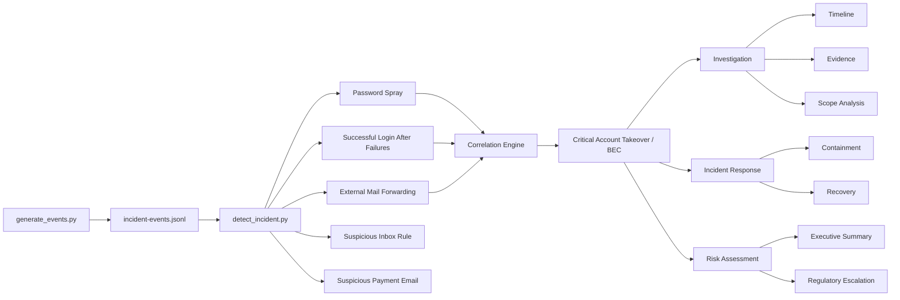

# Financial Security Incident Lab

A synthetic financial-sector security lab demonstrating **detection engineering, incident correlation, investigation, response, and cybersecurity risk communication** through a simulated account takeover and Business Email Compromise (BEC) scenario.

> **Safety:** All identities, domains, IP addresses, organizations, logs, and incident activity used in this project are fictional. No production systems, credentials, customer information, or real financial institution data are used.

---

## Detection Result

The lab generates a controlled account-takeover scenario, produces five independent security findings, and correlates related authentication and mailbox activity into a **critical, high-confidence BEC incident**.


```text
Type:       account_takeover_bec
Severity:   CRITICAL
Confidence: HIGH
User:       j.smith@summitcu.example
Source IP:  203.0.113.50
```

[View full detection output screenshot](screenshots/detect_incident.png)  
[View raw detection output](docs/detection-output.txt)

---

## What This Project Demonstrates

- Synthetic ECS-style security telemetry generation
- Password-spray and mailbox-rule detection engineering
- Multi-event correlation into a high-confidence security incident
- Timeline reconstruction, evidence analysis, and incident scoping
- Containment and incident-response documentation
- Translation of technical findings into business and regulatory risk

---

## Architecture



---

## Scenario

The simulated attack begins with **password spraying against multiple fictional employee identities**.

One targeted identity is successfully authenticated from the same source and is subsequently used to:

1. Create external mailbox forwarding
2. Create an inbox rule designed to conceal payment-related messages
3. Send updated payment instructions to internal financial personnel

The project intentionally treats these behaviors as separate findings before correlating them into a higher-confidence incident.

```text
Password Spray
      |
      v
Successful Authentication
      |
      v
Account Takeover
      |
      +--> External Mail Forwarding
      |
      +--> Suspicious Inbox Rule
      |
      +--> Payment-Related Email
      |
      v
Detection Correlation
      |
      v
Critical BEC Incident
      |
      +--> Investigation
      +--> Containment
      +--> Risk Assessment
      +--> Regulatory Review
```

---

## Synthetic Telemetry

The event generator creates a deterministic **14-event incident timeline** using fictional identities and documentation-only network resources.

The dataset uses:

- `.example` domains
- RFC 5737 documentation IP ranges
- Fictional user identities
- ECS-style nested fields including:
  - `event.action`
  - `event.outcome`
  - `event.dataset`
  - `user.email`
  - `source.ip`

The dataset is stored as JSON Lines:

```text
data/incident-events.jsonl
```

Each line represents one independent security event.


---

## Attack Timeline

| Time UTC | Activity | Assessment |
|---|---|---|
| 15:00 | Normal authentication | Establishes baseline activity |
| 15:14 | Password spray begins | Multiple identities targeted from one source |
| 15:18 | `j.smith` targeted | Future compromised identity enters attack sequence |
| 15:20 | Repeated authentication failure | Continued targeting |
| 15:21 | Successful authentication | Potential valid-account compromise |
| 15:27 | External forwarding created | BEC collection/persistence behavior |
| 15:31 | Inbox concealment rule created | Payment-related messages hidden |
| 15:42 | Updated payment instructions sent | Potential fraudulent activity |
| 15:47 | Correlation alert generated | Combined behavior escalated |
| 15:57 | Sessions revoked | Containment begins |
| 15:58 | Account disabled | Immediate unauthorized access stopped |

See the full [`incident timeline`](investigation/timeline.md) for the complete reconstruction.

---

## Detection Engineering

The Python detection engine identifies five independent findings:

1. **Password Spray**
2. **Successful Login After Failures**
3. **External Mail Forwarding**
4. **Suspicious Inbox Rule**
5. **Suspicious Payment Email**

A key design goal is to distinguish **suspicious events** from a **confirmed incident**.

For example, failed authentication or mailbox forwarding may each have legitimate explanations when viewed independently.

Confidence increases when the same source:

1. Fails authentication against multiple identities
2. Successfully authenticates to one of those identities
3. Creates external mailbox forwarding for the compromised account

The correlation engine therefore escalates the combined behavior to:

```text
account_takeover_bec
Severity: CRITICAL
Confidence: HIGH
```

---

## Sigma Detection Rules

Two Sigma-format detection artifacts are included.

### Password Spray

[`detections/password-spray.yml`](detections/password-spray.yml)

Uses a `value_count` correlation to identify failed authentication from one source IP against four or more distinct user identities within ten minutes.

### Mailbox Forwarding

[`detections/mailbox-forwarding-rule.yml`](detections/mailbox-forwarding-rule.yml)

Detects creation of mailbox forwarding configuration for additional analyst review.

The Python detection engine performs additional context-aware analysis, including comparing the mailbox owner's domain against the forwarding destination.

> **Note:** These Sigma rules use synthetic log sources and ECS-style fields. Production deployment would require appropriate field mapping for the target SIEM and validation of backend correlation support.

---

## MITRE ATT&CK Mapping

| Scenario Behavior | MITRE ATT&CK | Tactic |
|---|---|---|
| Password spraying against multiple identities | T1110.003 - Password Spraying | Credential Access |
| Successful use of compromised credentials | T1078 - Valid Accounts | Initial Access / Persistence / Privilege Escalation / Defense Evasion |
| External mailbox forwarding | T1114.003 - Email Forwarding Rule | Collection |

The mapping is intentionally limited to behavior directly supported by the synthetic evidence rather than assigning techniques simply to increase coverage.

---

## Investigation, Response & Risk

The lab carries the correlated incident beyond alert generation into investigation, containment, and business-risk communication.

| Area | Artifact |
|---|---|
| Timeline Reconstruction | [`investigation/timeline.md`](investigation/timeline.md) |
| Evidence Assessment | [`investigation/evidence.md`](investigation/evidence.md) |
| Scope Analysis | [`investigation/scope-analysis.md`](investigation/scope-analysis.md) |
| Containment Checklist | [`response/containment-checklist.md`](response/containment-checklist.md) |
| Incident Response Report | [`response/incident-response-report.md`](response/incident-response-report.md) |
| Executive Risk Summary | [`risk/executive-summary.md`](risk/executive-summary.md) |
| Regulatory Escalation | [`risk/regulatory-escalation.md`](risk/regulatory-escalation.md) |

The investigation intentionally distinguishes:

- **Confirmed evidence**
- **Potential impact**
- **Unresolved scope**
- **Recommended response actions**

For example:

```text
Potential Financial Impact: High
Confirmed Financial Loss:   None identified
```

This prevents possible impact from being presented as established fact.

---

## Incident Response

The synthetic response telemetry confirms two immediate containment actions:

- Active sessions were revoked
- The affected account was disabled

Those actions reduce immediate unauthorized access but do **not** establish that the incident is fully contained.

Additional investigation would still be required to determine whether:

- Other identities were compromised
- Additional malicious sessions exist
- Sensitive information was exposed
- Fraudulent transactions occurred
- Endpoint compromise or other persistence exists

---

## Regulatory Escalation

The project includes a simulated regulatory-escalation assessment to demonstrate how an analyst can identify potential reporting considerations without making unsupported legal conclusions.

The analyst's role is framed as:

1. Identify facts
2. Preserve evidence
3. Assess technical impact
4. Document uncertainty
5. Escalate potential regulatory implications
6. Support authorized decision-makers with accurate incident information

See [`risk/regulatory-escalation.md`](risk/regulatory-escalation.md).

---

## Quick Start

### Clone

```bash
git clone https://github.com/ktalons/financial-security-incident-lab.git
cd financial-security-incident-lab
```

### Runtime

The core lab uses Python 3 and the standard library only.

```bash
python3 -m venv .venv
source .venv/bin/activate
```

> A virtual environment is optional but recommended for local development.

### Generate the Dataset

```bash
python generator/generate_events.py
```

Expected:

```text
[+] Generated 14 synthetic events
[+] Scenario: password spray -> account takeover -> BEC activity
```

### Run Detection

```bash
python detections/detect_incident.py
```

Expected outcome:

```text
Detection finding count: 5

Severity:   CRITICAL
Confidence: HIGH
Type:       account_takeover_bec
```

---

## Detection Philosophy

> **A suspicious event is not automatically an incident.**

- Individual alerts provide evidence.
- Correlation provides context.
- Investigation establishes scope.
- Response reduces risk.
- Documentation communicates what is known and what remains uncertain.

---

## Key Takeaways

- **Correlation changes confidence.** Individual alerts may be ambiguous; related activity provides stronger evidence.
- **Scope must be evidence-driven.** One confirmed compromised identity does not prove that only one identity was affected.
- **Containment is not recovery.** Disabling an account stops immediate access but does not establish that all persistence or downstream impact has been resolved.
- **Technical findings must translate into risk.** Security telemetry matters because of what it may allow an adversary to do to business processes, financial operations, and sensitive information.
- **Uncertainty should remain explicit.** Potential impact should never be represented as confirmed impact without supporting evidence.

---

## Repository Structure

```text
financial-security-incident-lab/
│
├── data/
│   └── incident-events.jsonl
│
├── generator/
│   └── generate_events.py
│
├── detections/
│   ├── detect_incident.py
│   ├── password-spray.yml
│   └── mailbox-forwarding-rule.yml
│
├── investigation/
│   ├── timeline.md
│   ├── evidence.md
│   └── scope-analysis.md
│
├── response/
│   ├── containment-checklist.md
│   └── incident-response-report.md
│
├── risk/
│   ├── executive-summary.md
│   └── regulatory-escalation.md
│
├── docs/
│   └── detection-output.txt
│
├── screenshots/
│   ├── generate_events.png
│   ├── detect_incident.png
│   └── correlated_incident.png
│
├── .gitignore
└── README.md
```

---

## Future Improvements

Potential extensions include:

- Elastic/Kibana ingestion and dashboards
- Additional Sigma detections
- MFA and conditional-access telemetry
- Endpoint/EDR events
- Threat-intelligence enrichment
- Automated ATT&CK mapping
- Detection unit tests
- Additional BEC variants
- Third-party compromise scenarios

---

## Disclaimer

This repository is an educational cybersecurity project.

All organizations, identities, email addresses, IP addresses, logs, and incident activity are synthetic and intentionally fictional.

This project is not affiliated with or representative of any real financial institution.